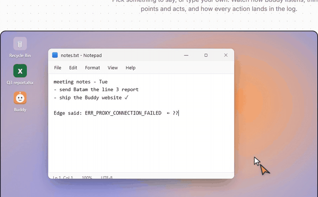

# Buddy

 Walks new engineers through clunky work software (PLM, SRM, ERP), click by click, or clicks for them. <a href="https://juw12.github.io/buddy/">Website and live demo</a> · <a href="https://github.com/juw12/buddy/releases/latest/download/Buddy-win64.zip">Download for Windows</a> · <a href="https://github.com/juw12/buddy/releases/latest/download/Buddy-mac.zip">Mac (Lite)</a>

> **Works out of the box:** Buddy starts on a free cloud brain, so there's no account, key or model download. For unlimited, private answers, add a local brain with [Ollama](https://ollama.com). The free brain's source is in [cloud/brain](cloud/brain).
>
> **On a Mac?** [Buddy Lite for Mac](mac/README.md) points and answers (hold Control+Option+Space), in English, Indonesian, Chinese and 11 more languages (menu bar, *Voice language*). One line in Terminal installs it: `curl -fsSL https://juw12.github.io/buddy/mac-install.sh | bash`. Clicking and typing for you, the Pips pet and key sounds are Windows-only for now.
>
> **On a phone, tablet or any other computer?** Open [juw12.github.io/buddy/island](https://juw12.github.io/buddy/island/) and add it to your home screen: tap to type, hold to talk, or share a screenshot to Buddy. See [Buddy Island](#buddy-island).
>
> **Tried it?** [Tell us how it went](https://github.com/juw12/buddy/issues/new?template=feedback.yml). It takes a minute.

Buddy is the app. It owns the tray icon, the main window, autostart and quitting.
It has three features:
- **Focus**: the Pips desktop pet and focus tracker, running inside Buddy.
- **Keyboard & mouse sounds**: KeyIt, plus a soft click for every mouse button (Settings: *Mouse clicks too*).
- **AI helper**: a local helper that looks at your screen and answers questions about it.

Click the orange Buddy icon by the clock to open the main window. Its tabs are Home, Focus, Keyboard sounds and AI helper.

## Run
- **App:** unzip `Buddy-win64.zip` anywhere and run `Buddy.exe`. You don't need Python.
- **From source:** run `setup.bat` once (it creates `.venv`, installs the requirements, and runs the self-test).
  After that, start Buddy with `start.bat`.
- **Build the app:** run `build.bat`. It writes `dist\Buddy\` and `dist\Buddy-win64.zip`. Your Pips data in
  `dist\Buddy\app\pips` is kept when you rebuild, and it is never put in the zip.

## Bring your Pips history along
Quit Pips first, or leave it running: the database is copied safely either way. Then run:

    Buddy.exe --import-pips "C:\path\to\your\pips"            (app)
    python buddy.py --import-pips "C:\path\to\your\pips"       (source)

This copies `config.json` and `data\`. Buddy only reads your original Pips folder. If Buddy already has a profile,
the import stops. Add `--force` to replace that profile; the old one is moved to `pips\backup\` first.

## Use
- **Ctrl+Alt+Space**, hold it: ask Buddy about your screen by voice. Release to send, and press Esc to cancel. Your question is heard in the language picked in the *Voice input* tab, and the model is asked to answer in the language of the question. A Chinese, Japanese or Hindi answer is spoken sentence by sentence, like an English one. An answer in a language without a natural voice (see **Voice** below) is read by the voice you picked.
- **Ctrl+Alt+D**: type by voice into any app (mail, chat, PLM forms, Word). Hold it while you talk and release, or tap it once to talk hands-free and tap again to type it (Esc cancels, 5 minutes max). Buddy drops "um"/"uh", follows corrections you say out loud ("at three, no wait, at four" types "at four"; "... scratch that" drops the sentence), and never touches your clipboard. Corrections also work in Indonesian and Malay ("jam tiga, eh salah, jam empat" types "jam empat"), Chinese ("三点，不对，四点"), German, Spanish and French; in other languages only the filler sounds are dropped. *Voice input -> Type last dictation again / Copy last dictation* if it went into the wrong window.
- **Ctrl+Alt+T**: talk with Buddy hands-free, like a call (also *Talk with Buddy* in the tray menu). There is no key to hold: Buddy waits until your sentence sounds finished (about 0.3 s after a complete sentence, 0.7 s when it can't tell, 1.6 s when you trail off on "and", "because" or "um"), starts speaking while the rest of the answer is still being written, and stops when you talk over it. End the conversation with Ctrl+Alt+T, Esc or by saying "goodbye". Use a headset: Buddy has no echo canceller, so through loudspeakers you must be clearly louder than its voice to interrupt it (or press Esc). How soon the answer starts depends on the brain (Smart about 1 to 2 s, Free about 5 s). Measurements and limits: [Talk mode vs Jev](#talk-mode-vs-jev). Switch it off with *Talk with Buddy* in Settings.
- **Language and speech model** (the *Voice input* tab): pick the language you speak and leave the model on *Auto*. Auto uses Whisper base.en for English (the most accurate in [our benchmark](#voice-buddy-vs-wispr-flow-vs-handy)), SenseVoice for Mandarin and Cantonese, Omnilingual for Indonesian, Dolphin for Malay, Japanese, Korean, Thai and Vietnamese, Parakeet V3 for German, Spanish, French and other European languages, and Whisper base when the language is *Auto-detect*. Chinese is typed in the characters you pick: Simplified for *Chinese, Simplified*, Traditional for *Chinese, Traditional* and for Cantonese. Indonesian, Malay, Japanese, Korean, Thai and Vietnamese are newer and make more mistakes than English or Chinese, so check names and numbers; the line under the picker says what to expect. All models run offline on this PC; the one for your language (80 to 490 MB) downloads once from GitHub in the background and resumes if the office network cuts it. For English, German, Spanish, French, Japanese and Chinese the Windows recognizer answers until it is ready (when that Windows speech language is installed); for the other languages voice input waits for the download, and if you try it too early the bubble says how far the download is. Silero voice detection runs first, so a key click or a fan never turns into made-up text. The microphone is picked on the same tab. While it turns your speech into text, Buddy asks Windows for above-normal priority and gives it back afterwards, so other busy programs hold dictation up less ([measured](bench/README.md#release-to-text-on-a-busy-pc)). A dictation longer than 15 seconds is turned into text in parts while you are still talking, so letting go of the key only waits for the last part, and English no longer loses what you say after the first 30 seconds ([measured](bench/README.md#long-dictations-release-to-text)).
- **My words** (Voice input -> My words...): one word per line that Buddy must always spell your way (`SRM`, `eGreen`, `PureGMS`: "s r m" and "e green" are fixed, near misses like "Zyris" -> `ZIRIS` too; with the language set to English, Chinese, Japanese, Korean or Thai also a mishearing that only sounds like it, such as "Bizaira's" -> `ZIRIS`), and spoken shortcuts like `my sign off => Best regards, Juwen`. If a real name sounds like one of your words, add the name too, so Buddy leaves it alone. Ordinary English words are left alone unless they are said exactly like your word ("speck green" -> `Spec Green`), so "not paid" never turns into `Notepad`; if Buddy keeps hearing real words for one of yours, add a line such as `peg vision => Pega-Vision`.
- **Voice**: Settings -> Voice. "Natural: ..." voices sound human (Kokoro, offline, ~120 MB downloaded once into %APPDATA%\Buddy\voices) in English (US/UK), Chinese (Mandarin), Spanish, French, Italian, Portuguese (Brazil) and Hindi. If Buddy answers in Chinese or Hindi while another language's voice is picked, a voice of the same gender reads that part; the Microsoft voices are the old robotic ones. Press **Test** to hear one. Natural voices run on the CPU, so on a very busy PC they can start a second or two later.
- **Brain** (Settings): *Free (cloud)* needs no setup: Llama 4 Scout on Cloudflare Workers AI through a small Worker ([cloud/brain](cloud/brain)), ~5 s answers, a shared daily limit, and the screenshot + question go to Cloudflare to be answered (not stored). With *Local GPU* picked and no local brain on the PC, Buddy uses the free brain automatically. *Smart (MAAS)* uses a big vision model on your company's AI gateway (~1-2 s answers, much smarter; your screenshot + question go to that gateway, logging in with the MAAS account from the Pips token card). Set `BUDDY_SMART_URL` (an OpenAI-compatible chat endpoint) and `BUDDY_SMART_MODEL` to point it at your gateway. *Local GPU* / *Local CPU* keep everything on this PC (~5-15 s / ~1 min). If MAAS can't be reached, Buddy answers locally for 5 minutes and then tries MAAS again.
- **Ctrl+Alt+Space**, tap it: a small ask box opens at your mouse, so you can type when you can't talk. If you had text highlighted, Buddy reads it too (through Windows accessibility, never the clipboard). Just pressing Enter means "explain this".
- Like Clicky, a small orange buddy rests next to your mouse all the time. It shows a waveform while it listens, a spinner while it thinks, and flies to whatever it points at. To see it only while you ask, untick *Settings → Keep Buddy next to my mouse all the time*.
- **Look** (Settings): pick the buddy's colour (10 colours or *Custom…*) and icon (arrow, mouse pointer, paper plane, dot, star, heart or the Buddy face). The colour is also used for its bubbles and the ask/confirm boxes.
- The buddy runs on its own thread with its own tiny window, so it keeps following the mouse even when the PC or the rest of Buddy is busy; after a hiccup it jumps straight back to the mouse instead of crawling after it.
  Buddy answers in the pet's speech bubble, reads it aloud, and draws an orange beam from the pet
  to whatever it is talking about.
- **Ctrl+Alt+M**: mute keyboard and mouse sounds.
- Buddy plays a short chime when it wakes up (Ctrl+Alt+Space or *Ask Buddy*) and a blip when it got your question. Turn it off with *Wake-up chime* in Settings.
- **Ctrl+Alt+P**: Pips's own hotkey (unchanged).
- Right-click the pet, then go to **Buddy** to find *Ask Buddy about my screen*, *Keyboard sounds*, and *Sounds & AI settings*.

For the private Local brain, run [Ollama](https://ollama.com) locally with a vision model,
for example `ollama pull qwen3-vl:4b-instruct`. Everything stays on this PC. Buddy also tells the model
your current Pips focus score, so answers can take your day into account.

**Speed (Use GPU, on by default):** Ollama runs only on the CPU on Intel Arc laptops, which takes about
70–140 s per screenshot. So Buddy starts Ollama's own bundled GPU server (Vulkan) with the model files
Ollama already downloaded. A fresh screenshot takes about 12–15 s, and a follow-up or a question asked
while you were still talking takes about 5 s. The GPU server stops after 30 min idle to free memory.
If the GPU path isn't available, Buddy uses Ollama on the CPU. You can untick *Use GPU (fast)* in
Settings to always use the CPU.

**Doing things:** ask Buddy to do something and it does it. For example: "close the file explorer", "close this", "minimize Outlook", "open notepad", "open google.com", "click Insert", "type hello", or "save it" (Ctrl+S). It only acts on requests; "how do I…" questions just get an answer and an arrow. If a window is frozen, Buddy asks before force-closing it. Frozen File Explorer windows are fixed by restarting Explorer, so the taskbar blinks once. Risky shortcuts like Alt+F4 also ask first.

Buddy only does what *your words* ask for. "Close notepad" can only close Notepad, never another window. It clicks only when you say click, press or select. It never clicks a window's own close or minimize buttons. If you name an app that isn't open, it refuses instead of typing into another window. Everything Buddy does is written to `app\pips\logs\widget.log`.

**From scripts or shortcuts:** `Buddy.exe --ask "open notepad"` hands a typed question to the running Buddy, the same as the Ctrl+Alt+Space box.

**Pointing:** the arrow snaps onto the exact button, tab or text box through Windows UI Automation.
This works in Office, browsers, Electron apps and the taskbar. In apps that draw their own UI, the
arrow goes to the model's estimate.

## Voice: Buddy vs Wispr Flow vs Handy
Measured with [bench/](bench/README.md) on Juwen's office laptop (Core Ultra 7 258V, behind the company proxy): 12 work questions
(SRM, eGreen, PureGMS, BOM, PLM, Pega-Vision...) read by two Windows voices, clean and with 10 dB of office noise, 4 Chinese
questions, and 4 clips with no speech at all (room tone, fan, key clicks, a breath). Lower is better.

| What you get when you talk | English errors (clean / noisy) | Chinese errors | Text made up from silence |
|---|---|---|---|
| Buddy before, on an office PC (download blocked -> Windows recognizer) | 37% / 87% | 42% | 1 of 4 |
| Buddy before, when Whisper could be downloaded | 7.5% / 7.0% | English only | **4 of 4** ("(buzzing)", "[BLANK_AUDIO]") |
| Parakeet V3 + voice detection (the engine Handy recommends) | 13.6% / 15.4% | English + Europe only | 0 of 4 |
| **Buddy now** (Whisper base.en + voice detection + My words) | **4.9% / 4.9%** | **0% / 1.5%** (SenseVoice) | **0 of 4** |

Wispr Flow is not in the table: it sends your voice to its cloud, which the office network and data rules don't allow, so it
couldn't be measured here. "Errors" is word error rate (character error rate for Chinese) against what the speaker meant; the
voices are synthetic (Windows TTS), so real voices will differ, but the order between the engines is what matters. Without
*My words* Buddy now scores 8.4% / 7.9% (the voice detection that removes all made-up text costs about one point). Speed: about
0.9 s from letting go to text on a quiet CPU, about 2 s while other heavy work runs.

| | Wispr Flow | Handy | Buddy |
|---|---|---|---|
| Price | Free up to 2,000 words a week, then paid | Free, open source | Free |
| Where your voice goes | Its cloud | Stays on the PC | Stays on the PC |
| Works behind the office proxy | No | Model downloads from HuggingFace are blocked | Yes (models come from GitHub, downloads resume) |
| Dictate into any app (hold, or tap for hands-free) | Yes | Yes | Yes (Ctrl+Alt+D), never touches the clipboard |
| Removes "um"/"uh", follows "no wait..." | Yes | Optional, through an AI model | Yes, built in and instant |
| Personal dictionary + spoken shortcuts | Yes | Custom words | Yes (*My words*) |
| Edit selected text by voice ("make this shorter") | Yes (Command Mode) | No | Yes (select text, Ctrl+Alt+D, say the change) |
| Chinese | Yes | With Whisper models | Yes, SenseVoice (0% errors above) |
| Ignores silence / noise | - | Yes (Silero) | Yes (Silero) |
| Sees your screen, points at buttons, clicks and types for you | No | No | Yes (Ctrl+Alt+Space) |

## Talk mode vs Jev
Jev is a cloud model that voice agents call to decide whether the speaker has finished a turn. It could not be run here
(vendor cloud, paid, and the office data rules), so **its column is what the vendor publishes, not something we measured**.
Buddy's column is measured with [bench/talk_turns.py](bench/talk_turns.py) on the same office laptop while it was busy with
other work (about 90% CPU load on 8 logical CPUs). Full tables: [bench/README.md](bench/README.md#talk-mode-turns-and-barge-in).

| | Jev (published by the vendor, not measured here) | Buddy talk mode (measured here) |
|---|---|---|
| Where it runs | Vendor cloud only | On your PC, offline |
| Price | $0.042 per million input tokens | Free |
| How it decides you are done | A model that reads the transcript | Hand-written rules that read the transcript (English, Indonesian, Chinese); other languages get a plain 0.7 s pause |
| Time for one decision, given the words | About 300 ms | 0.005 ms (p95) |
| Time for one decision, speech recognition included | 70 to 500 ms end to end | 0.46 s median, 0.87 s p95 at 90% CPU load |
| Finished or not, on our 48 synthetic clips | Not measured | 85% balanced accuracy, against 67% for a fixed 0.7 s pause |
| Stops talking when you interrupt | Not its job | Stop requested 0.2 s (p95) after you start, in a simulated room |

Where Buddy does **not** beat Jev, and what was not shown:
- Accuracy was never compared with Jev. Buddy's 85% is on 48 of our own English clips spoken by a synthetic voice (24 finished,
  24 cut off mid-sentence), against a fixed-pause baseline. It clears our 85% target by 0.4 points.
- Buddy has to run Whisper at every pause before the rules can read anything. On this busy PC that took 0.87 s (p95), slower
  than Jev's published figure and over our own 300 ms target. Counting that compute time, Buddy's accuracy drops to 72%, about
  the same as the best fixed pause (0.9 s: 73%).
- 7 clips that sound finished but where the speaker then adds more are left out of the accuracy. Buddy answered before the
  speaker went on in 43% of them at a 0.5 s pause and in all of them at 0.8 s and longer.
- There is no echo canceller. With a headset every interruption was noticed. Through loudspeakers you were noticed every time
  only when 3 times louder at the microphone than Buddy's echo (natural voice) or 4 times (Windows voice); below that, press Esc.
  Other people talking in the room are heard as you. Buddy never interrupted itself in 24 minutes of simulated echo.
- The speaker-to-microphone path was simulated and the voices are synthetic. Nobody has been measured at a real microphone
  yet, and how fast the voice stops on the real sound device was not measured (the device did not start in the bench).

## Buddy Island
Buddy lives in your screen's notch, so it is always one move away, on every device:

- **Windows:** a slim black island sits at the top centre of the monitor your mouse is on, flush with the
  top edge (or as a floating pill under a top taskbar). It never takes clicks until you rest the mouse on
  it for a moment; then it opens to *Ask Buddy*. **Click** it to type, **hold** it to talk. While Buddy
  works, the island shows the waveform, the thinking spinner and a short answer. Click the answer to dismiss
  it, right-click for Settings. It hides during full-screen apps and presentations, and never shows up in
  the screenshot Buddy takes. Turn it off with *Settings → Buddy Island at the top of the screen*.
- **Mac:** on MacBooks with a notch the island wraps the real notch (its wings grow out of both sides);
  on other Macs it hangs from the top centre of the screen. Click to type, hold to talk. Menu: *Buddy Island
  in the notch*.
- **Phone, tablet, Chromebook, Linux, any browser:** [juw12.github.io/buddy/island](https://juw12.github.io/buddy/island/)
  is a small web app on the free brain. Add it to the home screen (Share → *Add to Home Screen* on iPhone,
  *Install* on Android/Chrome). Tap the island to type, hold it to talk, attach or **share a screenshot**
  to Buddy (Android share sheet) and it points at the answer on your picture and reads it out. On a computer,
  *Pop Buddy out* keeps a tiny always-on-top island over your other windows (Chrome/Edge). Links:
  `…/island/?q=your+question` asks straight away, `…/island/?talk=1` starts listening (handy for an iPhone
  Shortcut on the Action Button or Back Tap).

- **iPhone app (real Dynamic Island):** the free [Buddy for iPhone](ios/README.md) app lives in the actual
  Dynamic Island as a Live Activity (and on the Lock Screen). Back Tap / Action Button → *Ask Buddy about my
  screen* answers about your last screenshot without leaving your app. Install the unsigned
  `Buddy-iOS.ipa` with Sideloadly or AltStore and your free Apple ID.

Honest limits: the web island can't sit in the iPhone's real Dynamic Island (use the iPhone app for that),
and a phone web app can't see your other apps, so on a phone you show Buddy a
screenshot. The web island uses the shared free brain and its daily limit; nothing is stored.

## Updates
Buddy keeps itself up to date. Windows and Mac check
[juw12.github.io/buddy/latest.json](https://juw12.github.io/buddy/latest.json) a minute after start and
every 3 hours. They download the new version, check its size and SHA-256, run its self-test, and swap only
when you are idle. Your settings, voices and history stay. If the new version fails, the old one comes back.
Tray / menu bar: *Check for updates*. From a terminal: `Buddy.exe --update`. Log:
`.buddy-update\update.log` next to the Buddy folder. The iPhone app shows a banner when a new version is out;
AltStore users can add the source `https://juw12.github.io/buddy/altstore.json`. The web island refreshes
itself.

## Data
- Pips data (tasks, history, config) is stored in `pips/data` and `pips/config.json`. In the app, that is
  `Buddy\app\pips\data` and `Buddy\app\pips\config.json`.
- Autostart (pet menu: Autostart, or the "Start with Windows" setting) adds `Buddy.lnk` to your Startup folder.
  It doesn't change a standalone `Pips.lnk`.
- Sound and AI settings are stored in `%APPDATA%\Buddy`. You can override this with the `KEYIT_HOME` environment variable.

## Notes
- Don't run standalone Pips and Buddy at the same time. Both would track your activity, and they would
  fight over Ctrl+Alt+P.
- Pips's built-in updater is disabled inside Buddy, because updates ship with Buddy.
- `python buddy.py --selftest` runs the Pips self-test with all Buddy parts attached.

## Layout
- `buddy.py`: the launcher (`--selftest`, `--import-pips`).
- `pips_import.py`: copies a Pips profile into Buddy (SQLite online backup with an integrity check).
- `buddy.spec` and `build.bat`: the PyInstaller onedir build. The sources ship as plain files in `app\`.
- `buddy_host.py`: BuddyApp, the boss. It owns the Tk root, the tray, single-instance, quitting and autostart.
  It also contains FocusFeature (Pips running under Buddy's root), the pet menu and the pet-guide overlay.
- `buddy_home.py`: the Home and Focus tabs of the Buddy window.
- `assets/buddy.ico`: Buddy's icon. `make_buddy_icon.py` draws it.
- `pips/`: Pips v2.28.0 source, unmodified.
- `keyit/`: KeyIt modules, patched so they can be hosted inside Buddy.

## License

Released under the [MIT License](LICENSE) © 2026 Juwen Lie. Contributions are welcome under the same license; see the [contributing guide](https://github.com/juw12/.github/blob/main/CONTRIBUTING.md) and [Code of Conduct](https://github.com/juw12/.github/blob/main/CODE_OF_CONDUCT.md).
