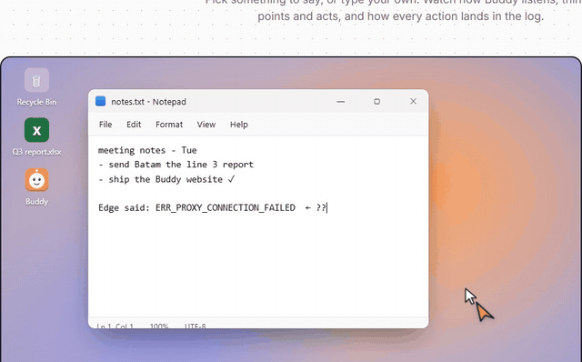

# Buddy

<p align="center"><a href="https://juw12.github.io/buddy/"></a><br><sub>Walks new engineers through clunky work software (PLM, SRM, ERP), click by click, or clicks for them. <a href="https://juw12.github.io/buddy/">Website and live demo</a> · <a href="https://github.com/juw12/buddy/releases/latest/download/Buddy-win64.zip">Download for Windows</a> · <a href="https://github.com/juw12/buddy/releases/latest/download/Buddy-mac.zip">Mac (Lite)</a></sub></p>

> **Works out of the box:** Buddy starts on a free cloud brain, so there's no account, key or model download. For unlimited, private answers, add a local brain with [Ollama](https://ollama.com). The free brain's source is in [cloud/brain](cloud/brain).
>
> **On a Mac?** [Buddy Lite for Mac](mac/README.md) points and answers (hold Control+Option+Space), in English, Indonesian, Chinese and 11 more languages (menu bar, *Voice language*). One line in Terminal installs it: `curl -fsSL https://juw12.github.io/buddy/mac-install.sh | bash`. Clicking and typing for you, the Pips pet and key sounds are Windows-only for now.
>
> **On a phone, tablet or any other computer?** Open [juw12.github.io/buddy/island](https://juw12.github.io/buddy/island/) and add it to your home screen: tap to type, hold to talk, or share a screenshot to Buddy. See [Buddy Island](#buddy-island).
>
> **Tried it?** [Tell us how it went](https://github.com/juw12/buddy/issues/new?template=feedback.yml). It takes a minute.

Buddy is the app. It owns the tray icon, the main window, autostart and quitting.
It has three features:
- **Focus**: the Pips desktop pet and focus tracker, running inside Buddy.
- **Keyboard & mouse sounds**: KeyIt, plus a soft click for every mouse button (Settings: *Mouse clicks too*).
- **AI helper**: a local helper that looks at your screen and answers questions about it.

Click the orange Buddy icon by the clock to open the main window. Its tabs are Home, Focus, Keyboard sounds and AI helper.

## Run
- **App:** unzip `Buddy-win64.zip` anywhere and run `Buddy.exe`. You don't need Python.
- **From source:** run `setup.bat` once (it creates `.venv`, installs the requirements, and runs the self-test).
  After that, start Buddy with `start.bat`.
- **Build the app:** run `build.bat`. It writes `dist\Buddy\` and `dist\Buddy-win64.zip`. Your Pips data in
  `dist\Buddy\app\pips` is kept when you rebuild, and it is never put in the zip.

## Bring your Pips history along
Quit Pips first, or leave it running: the database is copied safely either way. Then run:

    Buddy.exe --import-pips "C:\path\to\your\pips"            (app)
    python buddy.py --import-pips "C:\path\to\your\pips"       (source)

This copies `config.json` and `data\`. Buddy only reads your original Pips folder. If Buddy already has a profile,
the import stops. Add `--force` to replace that profile; the old one is moved to `pips\backup\` first.

## Use
- **Ctrl+Alt+Space**, hold it: ask Buddy about your screen by voice. Release to send, and press Esc to cancel. Your question is heard in the language picked in the *Voice input* tab, and the model is asked to answer in the language of the question. A Chinese, Japanese or Hindi answer is spoken sentence by sentence, like an English one. An answer in a language without a natural voice (see **Voice** below) is read by the voice you picked.
- **Ctrl+Alt+D**: type by voice into any app (mail, chat, PLM forms, Word). Hold it while you talk and release, or tap it once to talk hands-free and tap again to type it (Esc cancels, 5 minutes max). Buddy drops "um"/"uh", follows corrections you say out loud ("at three, no wait, at four" types "at four"; "... scratch that" drops the sentence), and never touches your clipboard. Corrections also work in Indonesian and Malay ("jam tiga, eh salah, jam empat" types "jam empat"), Chinese ("三点，不对，四点"), German, Spanish and French; in other languages only the filler sounds are dropped. *Voice input -> Type last dictation again / Copy last dictation* if it went into the wrong window.
- **Ctrl+Alt+T**: talk with Buddy hands-free, like a call (also *Talk with Buddy* in the tray menu). There is no key to hold: Buddy waits until your sentence sounds finished (about 0.3 s after a complete sentence, 0.7 s when it can't tell, 0.9 s when it could go either way, as after "we could" or "before", and 1.6 s when you trail off on "and", "because" or "um"), starts speaking while the rest of the answer is still being written, and stops when you talk over it. End the conversation with Ctrl+Alt+T, Esc or by saying "goodbye". Use a headset: Buddy has no echo canceller, so through loudspeakers you must be clearly louder than its voice to interrupt it (or press Esc). How soon the answer starts depends on the brain (Smart about 1 to 2 s, Free about 5 s). Measurements and limits: [Talk mode vs Jev](#talk-mode-vs-jev). Switch it off with *Talk with Buddy* in Settings.
- **Language and speech model** (the *Voice input* tab): pick the language you speak and leave the model on *Auto*. Auto uses Whisper base.en for English (the most accurate in [our benchmark](#voice-buddy-vs-wispr-flow-vs-handy)), SenseVoice for Mandarin and Cantonese, Omnilingual for Indonesian, Dolphin for Malay, Japanese, Korean, Thai and Vietnamese, Parakeet V3 for German, Spanish, French and other European languages, and Whisper base when the language is *Auto-detect*. Chinese is typed in the characters you pick: Simplified for *Chinese, Simplified*, Traditional for *Chinese, Traditional* and for Cantonese. Indonesian, Malay, Japanese, Korean, Thai and Vietnamese are newer and make more mistakes than English or Chinese, so check names and numbers; the line under the picker says what to expect. All models run offline on this PC; the one for your language (80 to 490 MB) downloads once from GitHub in the background and resumes if the office network cuts it. For English, German, Spanish, French, Japanese and Chinese the Windows recognizer answers until it is ready (when that Windows speech language is installed); for the other languages voice input waits for the download, and if you try it too early the bubble says how far the download is. Silero voice detection runs first, so a key click or a fan never turns into made-up text. The microphone is picked on the same tab. While it turns your speech into text, Buddy asks Windows for above-normal priority and gives it back afterwards, so other busy programs hold dictation up less ([measured](bench/README.md#release-to-text-on-a-busy-pc)). A dictation longer than 15 seconds is turned into text in parts while you are still talking, so letting go of the key only waits for the last part, and English no longer loses what you say after the first 30 seconds ([measured](bench/README.md#long-dictations-release-to-text)).
- **My words** (Voice input -> My words...): one word per line that Buddy must always spell your way (`SRM`, `eGreen`, `PureGMS`: "s r m" and "e green" are fixed, near misses like "Zyris" -> `ZIRIS` too; with the language set to English, Chinese, Japanese, Korean or Thai also a mishearing that only sounds like it, such as "Bizaira's" -> `ZIRIS`), and spoken shortcuts like `my sign off => Best regards, Juwen`. If a real name sounds like one of your words, add the name too, so Buddy leaves it alone. Ordinary English words are left alone unless they are said exactly like your word ("speck green" -> `Spec Green`), so "not paid" never turns into `Notepad`; if Buddy keeps hearing real words for one of yours, add a line such as `peg vision => Pega-Vision`.
- **Voice**: Settings -> Voice. "Natural: ..." voices sound human (Kokoro, offline, ~120 MB downloaded once into %APPDATA%\Buddy\voices) in English (US/UK), Chinese (Mandarin), Spanish, French, Italian, Portuguese (Brazil) and Hindi. If Buddy answers in Chinese or Hindi while another language's voice is picked, a voice of the same gender reads that part; the Microsoft voices are the old robotic ones. Press **Test** to hear one. Natural voices run on the CPU, so on a very busy PC they can start a second or two later.
- **Brain** (Settings): *Free (cloud)* needs no setup: Llama 4 Scout on Cloudflare Workers AI through a small Worker ([cloud/brain](cloud/brain)), ~5 s answers, a shared daily limit, and the screenshot + question go to Cloudflare to be answered (not stored). With *Local GPU* picked and no local brain on the PC, Buddy uses the free brain automatically. *Smart (MAAS)* uses a big vision model on your company's AI gateway (~1-2 s answers, much smarter; your screenshot + question go to that gateway, logging in with the MAAS account from the Pips token card). Set `BUDDY_SMART_URL` (an OpenAI-compatible chat endpoint) and `BUDDY_SMART_MODEL` to point it at your gateway. *Local GPU* / *Local CPU* keep everything on this PC (~5-15 s / ~1 min). If MAAS can't be reached, Buddy answers locally for 5 minutes and then tries MAAS again.
- **Ctrl+Alt+Space**, tap it: a small ask box opens at your mouse, so you can type when you can't talk. If you had text highlighted, Buddy reads it too (through Windows accessibility, never the clipboard). Just pressing Enter means "explain this".
- Like Clicky, a small orange buddy rests next to your mouse all the time. It shows a waveform while it listens, a spinner while it thinks, and flies to whatever it points at. To see it only while you ask, untick *Settings → Keep Buddy next to my mouse all the time*.
- **Look** (Settings): pick the buddy's colour (10 colours or *Custom…*) and icon (arrow, mouse pointer, paper plane, dot, star, heart or the Buddy face). The colour is also used for its bubbles and the ask/confirm boxes.
- The buddy runs on its own thread with its own tiny window, so it keeps following the mouse even when the PC or the rest of Buddy is busy; after a hiccup it jumps straight back to the mouse instead of crawling after it.
  Buddy answers in the pet's speech bubble, reads it aloud, and draws an orange beam from the pet
  to whatever it is talking about.
- **Crew:** other AI agents working on this PC (Claude Code, Codex, OpenCode) show up as extra pointers with their own names and colours, and `@opencode …` in the ask box hands your question to that agent: [Crew](#crew-your-other-ai-agents-as-pointers).
- **Ctrl+Alt+M**: mute keyboard and mouse sounds.
- Buddy plays a short chime when it wakes up (Ctrl+Alt+Space or *Ask Buddy*) and a blip when it got your question. Turn it off with *Wake-up chime* in Settings.
- **Ctrl+Alt+P**: Pips's own hotkey (unchanged).
- Right-click the pet, then go to **Buddy** to find *Ask Buddy about my screen*, *Keyboard sounds*, and *Sounds & AI settings*.

For the private Local brain, run [Ollama](https://ollama.com) locally with a vision model,
for example `ollama pull qwen3-vl:4b-instruct`. Everything stays on this PC. Buddy also tells the model
your current Pips focus score, so answers can take your day into account.

**Speed (Use GPU, on by default):** Ollama runs only on the CPU on Intel Arc laptops, which takes about
70–140 s per screenshot. So Buddy starts Ollama's own bundled GPU server (Vulkan) with the model files
Ollama already downloaded. A fresh screenshot takes about 12–15 s, and a follow-up or a question asked
while you were still talking takes about 5 s. The GPU server stops after 30 min idle to free memory.
If the GPU path isn't available, Buddy uses Ollama on the CPU. You can untick *Use GPU (fast)* in
Settings to always use the CPU.

**Doing things:** ask Buddy to do something and it does it. For example: "close the file explorer", "close this", "minimize Outlook", "open notepad", "open google.com", "click Insert", "type hello", or "save it" (Ctrl+S). It only acts on requests; "how do I…" questions just get an answer and an arrow. If a window is frozen, Buddy asks before force-closing it. Frozen File Explorer windows are fixed by restarting Explorer, so the taskbar blinks once. Risky shortcuts like Alt+F4 also ask first. Simple one-step commands ("minimize excel", "switch to outlook", "open notepad") are done at once, without asking the brain; anything less plain is thought over first: [Thinking fast and slow](#thinking-fast-and-slow-buddy-vs-jev).

Buddy only does what *your words* ask for. "Close notepad" can only close Notepad, never another window. It clicks only when you say click, press or select. It never clicks a window's own close or minimize buttons. If you name an app that isn't open, it refuses instead of typing into another window. Everything Buddy does is written to `app\pips\logs\widget.log`.

**From scripts or shortcuts:** `Buddy.exe --ask "open notepad"` hands a typed question to the running Buddy, the same as the Ctrl+Alt+Space box.

**Pointing:** the arrow snaps onto the exact button, tab or text box through Windows UI Automation.
This works in Office, browsers, Electron apps and the taskbar. In apps that draw their own UI, the
arrow goes to the model's estimate.

## Voice: Buddy vs Wispr Flow vs Handy
Measured with [bench/](bench/README.md) on Juwen's office laptop (Core Ultra 7 258V, behind the company proxy): 12 work questions
(SRM, eGreen, PureGMS, BOM, PLM, Pega-Vision...) read by two Windows voices, clean and with 10 dB of office noise, 4 Chinese
questions, and 4 clips with no speech at all (room tone, fan, key clicks, a breath). Lower is better.

| What you get when you talk | English errors (clean / noisy) | Chinese errors | Text made up from silence |
|---|---|---|---|
| Buddy before, on an office PC (download blocked -> Windows recognizer) | 37% / 87% | 42% | 1 of 4 |
| Buddy before, when Whisper could be downloaded | 7.5% / 7.0% | English only | **4 of 4** ("(buzzing)", "[BLANK_AUDIO]") |
| Parakeet V3 + voice detection (the engine Handy recommends) | 13.6% / 15.4% | English + Europe only | 0 of 4 |
| **Buddy now** (Whisper base.en + voice detection + My words) | **4.9% / 4.9%** | **0% / 1.5%** (SenseVoice) | **0 of 4** |

Wispr Flow is not in the table: it sends your voice to its cloud, which the office network and data rules don't allow, so it
couldn't be measured here. "Errors" is word error rate (character error rate for Chinese) against what the speaker meant; the
voices are synthetic (Windows TTS), so real voices will differ, but the order between the engines is what matters. Without
*My words* Buddy now scores 8.4% / 7.9% (the voice detection that removes all made-up text costs about one point). Speed: about
0.9 s from letting go to text on a quiet CPU, about 2 s while other heavy work runs.

| | Wispr Flow | Handy | Buddy |
|---|---|---|---|
| Price | Free up to 2,000 words a week, then paid | Free, open source | Free |
| Where your voice goes | Its cloud | Stays on the PC | Stays on the PC |
| Works behind the office proxy | No | Model downloads from HuggingFace are blocked | Yes (models come from GitHub, downloads resume) |
| Dictate into any app (hold, or tap for hands-free) | Yes | Yes | Yes (Ctrl+Alt+D), never touches the clipboard |
| Removes "um"/"uh", follows "no wait..." | Yes | Optional, through an AI model | Yes, built in and instant |
| Personal dictionary + spoken shortcuts | Yes | Custom words | Yes (*My words*) |
| Edit selected text by voice ("make this shorter") | Yes (Command Mode) | No | Yes (select text, Ctrl+Alt+D, say the change) |
| Chinese | Yes | With Whisper models | Yes, SenseVoice (0% errors above) |
| Ignores silence / noise | - | Yes (Silero) | Yes (Silero) |
| Sees your screen, points at buttons, clicks and types for you | No | No | Yes (Ctrl+Alt+Space) |

## Talk mode vs Jev
Jev is a cloud model that voice agents call to decide whether the speaker has finished a turn. It could not be run here
(vendor cloud, paid, and the office data rules), so **its column is what the vendor publishes, not something we measured**.
Buddy's column is measured with [bench/talk_turns.py](bench/talk_turns.py) on the same office laptop while it was busy with
other work (91% and 92% CPU load on 8 logical CPUs in the two latest runs). Full tables: [bench/README.md](bench/README.md#talk-mode-turns-and-barge-in).

| | Jev (published by the vendor, not measured here) | Buddy talk mode (measured here) |
|---|---|---|
| Where it runs | Vendor cloud only | On your PC, offline |
| Price | $0.042 per million input tokens | Free |
| How it decides you are done | A model that reads the transcript | Hand-written rules that read the transcript (English, Indonesian, Chinese); other languages get a plain 0.7 s pause |
| Time for one decision, given the words | About 300 ms | 0.005 ms (p95) |
| Time for one decision, speech recognition included | 70 to 500 ms end to end | **Slower:** 0.39 s median. p95 was 1.36 s and 0.66 s in two runs reading one clip at a time, and 4.1 s and 5.0 s in the real-time pass (2.86 s a round earlier), at 91% to 92% CPU load. The read starts 0.1 s into a pause, so a finished turn that was taken came a median 0.04 s (p95 0.28 to 0.35 s) later than the audio alone allows |
| Finished or not, on our synthetic clips | Not measured | 92.9% balanced accuracy on 192 clips in four lists (90.3% on the 48 newest), against 66.5% for a fixed 0.7 s pause and 73.3% for the best fixed pause. With real recognition time counted: 89.8% and 89.2% in two runs |
| What leaves your PC to decide this | The transcript of what you said | Nothing (your question still goes to the brain you picked) |
| Stops talking when you interrupt | Not its job | Stop requested 0.2 s (p95) after you start, in a simulated room. On the real sound device the voice was silent 0.05 s after the request (8 rounds, silent samples) |

Where Buddy does **not** beat Jev, and what was not shown:
- Accuracy was never compared with Jev. Buddy's figures are on our own English clips spoken by a synthetic voice, half
  finished and half cut off mid-sentence, against a fixed-pause baseline. There are four lists of 48 clips by the same
  author: 95.8%, 92.4%, 93.1% and 90.3%. The first three are **not** blind: this round's rules were written from their
  misses. The fourth was written after those rules, by the person who wrote them, and had never been read before; on the
  same reads the rules of the round before score 85.4% on it. The lists are parallel forms of each other, not a sample
  of real talk.
- Buddy has to run Whisper at every pause before the rules can read anything. The read starts 0.1 s into a pause on a
  thread that is kept running, and Buddy holds above-normal priority for the whole conversation. On this busy PC one
  read still took 0.39 s (median); the slowest 1 in 20 took 0.66 to 1.36 s one clip at a time and 4.1 to 5.0 s in the
  real-time pass. That is slower than Jev's published figure, and our own 300 ms target is **missed**.
- Counting that time, Buddy's accuracy is 89.8% and 89.2% in two runs (82.6% a round earlier), above the best fixed pause
  (73.3%) on every one of the four lists in both runs, the newest included (87.5% and 88.2% against 72.2%).
- 10 and 11 of 96 finished turns were not taken within 1.0 s, and 9 and 8 of those were not taken at all because one read
  took 2.8 to 6.3 s. The cause was found: the laptop's firmware slows the processor to about a fifth of its speed for
  seconds at a time (all 9 reads over 1.5 s in a separate probe ran at 18% to 71% speed; quick reads ran at 112% to
  175%). Buddy cannot switch that off and fewer threads did not help, so it is **not fixed**. It has not been measured on
  a cool or quiet PC. Whisper tiny.en and three other engines were tried and none was adopted
  ([table](bench/README.md#talk-mode-turns-and-barge-in)).
- 7 questions that sound finished but where the speaker then adds more are left out of the accuracy. At a 0.5 s pause
  Buddy answered before the speaker went on in 4 of the 7, and at 0.8 s and longer in all of them. If Buddy has been
  audible for less than 0.5 s when that happens, it joins the two parts into one question: the joined question had every
  scripted word in order in 12 of the 18 early answers (96% of the words on average). After 0.5 s of Buddy's voice the
  second part is a new question. How soon Buddy is audible depends on the brain and was not measured.
- 20 of the 96 cut-off clips were still taken as finished before a 1.2 s pause was over, 2 of them before 0.5 s. Eight of
  them end on a word Whisper heard as another one ("my" as "mine.", "the" as "them." or "that."), so the words look
  finished; telling those apart needs the melody of the voice, which Buddy does not use. Eight more end on "we could",
  "we should" or "before": Buddy now waits 0.9 s there, which holds through a 0.8 s pause but not a 1.2 s one.
- There is no echo canceller. With a headset every interruption was noticed. Through loudspeakers you were noticed every time
  only when 3 times louder at the microphone than Buddy's echo (natural voice) or 4 times (Windows voice); below that, press Esc.
  Other people talking in the room are heard as you. Buddy never interrupted itself in 24 minutes of simulated echo.
- The speaker-to-microphone path was simulated and the voices are synthetic. Nobody has been measured at a real microphone
  yet. On the real sound device (silent samples, 8 rounds) the voice was silent 0.05 s after a pause request and the
  device was idle 0.2 s (median) after a stop, with one stop that took 3.3 s. The interruption and sound-device figures
  are from the round before and were not measured again this round.

## Thinking fast and slow: Buddy vs Jev
Daniel Kahneman's *Thinking, Fast and Slow* describes two ways of deciding: System 1 is quick and automatic, System 2
is slow and careful, and System 2 is called in when System 1 has no ready answer. Jev (TypeSafe AI) calls itself a
"System One model": a cloud model that returns a typed answer with a probability, so that your code can "decide when to
act and when to escalate to a person or a reasoning model" ([their docs](https://docs.typesafe.ai/concepts/system-one),
read 17 Nov 2026). Jev is the fast half. The slow half, the handoff and the thresholds are yours to build.

Buddy has both halves and the handoff between them, on your PC ([keyit/keyit_minds.py](keyit/keyit_minds.py)):

- **System 1** does a routine one-step command at once, with no screenshot and no brain: close, minimize, maximize or
  switch to an open window you name by its app, or open an app or website it knows. It reads 40 ways of saying so
  ("quit outlook", "bring up excel", "make notepad full screen") and the polite words around them ("can you close
  notepad", "minimize excel please").
- **Strain hands over to System 2** (the brain that looks at your screen): a question, two steps ("and", "then"), a
  "don't", an "if", "all" or "every", a "maybe" or "should", more than 8 words, highlighted text, "it" or "that", or a
  window System 1 cannot pin down (two Notepads, or an app that is not open).
- **The bar rises with what a mistake would cost.** System 1 must be 0.80 sure to switch, minimize or maximize, 0.85 to
  open, 0.90 to press keys and 0.95 to close. That is why "close this" still goes to the brain: System 1 is 0.86 sure
  of it, because "this" is sometimes a tab, a file or a dialog.
- **Its confidence is trained, then checked (new in 1.6.0).** Kahneman's test for trusting an intuition is a lot of
  practice with quick feedback. Waiting for that from real use would take months, so System 1 practised on simulated
  use: 30,000 requests a program wrote from a known wish, and 636 written by a language model playing people. A small
  model (57 weights, [keyit/minds_model.json](keyit/minds_model.json)) learned how often a reading worded like this
  one was what the person wanted. It was calibrated on other simulated people, then scored once on requests the
  simulator did not write (the table below). What it never met in training it does not guess at.
- **Practice makes a habit.** When the brain does the same single step for the same short phrase again and again, System 1
  takes it over: after 3 times for switch, minimize and maximize, 5 for open, 8 for a shortcut ("next tab") and 18 for
  close. Typing, clicking, risky shortcuts and targets the brain read off the screen never become habits.
- **"No" teaches it.** Say or type "no", "not that", "wrong" or "undo" within 30 seconds of a fast action and it counts
  against the kind of reading or the habit that fired. Since 1.6.0 a "no" said over Buddy's reply in talk mode counts
  too. Your "no" can only lower the trained confidence, never raise it above what training gave.

Jev could not be run here: its API asks for a paid key, and the office data rules apply. So **its column is what the
vendor publishes and what one third party measured, not something we measured**. The third party is
[tsukumo.ch](https://tsukumo.ch/journal/jev-bounded-probability-benchmark) (23 Sep 2026), who ran jev-1.13.0 on Swiss
bookkeeping data. Buddy's column is measured with [bench/fast_calibration.py](bench/fast_calibration.py) and
[bench/fast_slow.py](bench/fast_slow.py) on the office laptop under heavy load. Full tables:
[bench/README.md](bench/README.md#thinking-fast-and-slow).

| Kahneman's idea | Jev (vendor or third party, not measured here) | Buddy (measured here) |
|---|---|---|
| System 1: a quick, automatic answer | **Much broader:** a trained model that answers any question you define (one of a list, a score, yes or no, a box in an image), from text, JSON and images (vendor) | A small model trained on simulated use, for five kinds of one-step command, in English, plus the habits it picks up |
| System 2: slow and careful | Not included. You bring the reasoning model | Built in: the brain that looks at your screen (Free, Smart or Local) |
| System 2 is called when System 1 is under strain | You write the routing from its probabilities | Built in: the strain signs above, and a confidence bar |
| Saying "I don't know" | No native abstention: you add "none of the above" as one of the options (third party) | Built in: what System 1 has not practised goes to the brain. 0 fast actions on 5,500 requests people wrote for other assistants |
| A loss weighs more than a gain | Thresholds are yours to pick | Built in: 0.80 to switch, 0.95 to close. Every action met its bar on the held-out sets |
| An honest confidence | The vendor says it is trained to be calibrated, but "has published no reliability diagram, no expected calibration error, no Brier score" (third party). The third party measured it: calibration error (ECE) 0.082 on 54 bookkeeping items, all 54 right; 0.011 on 28 easy VAT items; 0.615 on 10 expense claims, where 7 wrong answers came back 0.83 to 0.95 sure | ECE 0.028 on 233 held-out readings, 224 right, with the [reliability table](bench/results_calibration/fast_calibration.md) published. A different and much narrower task, and both samples are small: not a like-for-like win |
| Skill comes from practice with feedback | The vendor trains the model; nothing is learned from your use | Simulated practice with known answers before it ships; then habits from what the brain did for you, and "no" counts against them, typed or spoken. Kept on your PC |
| Time for one decision | 70 to 500 ms (vendor); 258 to 297 ms median, 640 ms at p99 (third party) | 0.016 ms median, 0.039 ms p95 |
| From the words to done | Not its job | 0.009 s median, 0.202 s slowest (closing a window), in 19 real window actions by the code inside the built 1.6.0. The free brain took 3.35 s (2.93 to 4.19 s) just to reply to the same kind of command (measured for 1.5.0) |
| Where it runs, price | Vendor cloud, $0.042 per million input tokens | On your PC, free, nothing is sent |

The trained System 1 against the hand-counted System 1 of Buddy 1.5.0, on sets that were not used to write the rules,
to train or to calibrate. Each was scored once, after the model was frozen. Raw rows:
[bench/results_calibration](bench/results_calibration/fast_calibration.md).

| Held-out set | Requests | One-step commands | Done at once and right (1.5.0 -> 1.6.0) | Wrong fast actions (1.5.0 -> 1.6.0) |
|---|---|---|---|---|
| Simulated users: four people played by Mistral Small 3.1, a different language model than the one in training | 364 | 191 | 23 -> 42 | 0 -> 0 |
| Microsoft's Voice Access command list (app and window commands; labels are ours) | 44 | 38 | 29 -> 31 | 0 -> 0 |
| The held-out list of Buddy 1.5.0 | 94 | 49 | 43 -> 40 | 0 -> 0 |
| CLINC150: requests people wrote for other assistants | 5,500 | 0 | 0 -> 0 | 0 -> 0 |
| Simulated speech: 100 simulated requests said by a synthetic voice (Kokoro) and heard by Buddy's own recognizer | 100 | 75 | 14 -> 43 | 0 -> 0 |
| The same 100, a second synthetic voice | 100 | 75 | 14 -> 45 | 0 -> 0 |
| In the simulator that trained it (a seed it did not train on) | 20,000 | 12,957 | 2,783 -> 9,302 | 183 -> 90 |

On the first four sets together System 1 took 114 fast actions and none was wrong, so the true share of wrong ones is
under 2.6% (95% bound). With the two speech sets it is 202 and none wrong, but those are the same 100 requests twice.

Where Buddy does **not** beat Jev, and what was not shown:
- Jev is a general model: any question, any domain, images too, and it was right in four languages in the third
  party's small test. Buddy's System 1 knows five kinds of desktop command in English and cannot be pointed at
  another job.
- Jev got 54 of 54 right on a real bookkeeping task. Buddy has no result on real people's requests at all: the
  training data is simulated, and so are the "users" in the test. They are a second author who never saw Buddy's
  rules, not a sample of what people say.
- On those simulated users System 1 did 42 of the 191 one-step commands (22%). The rest went to the brain, mostly
  because the wording was not one it knows (49) or it could not tell which window was meant (41).
- On the held-out list of 1.5.0 it does fewer than before, 40 of 49 against 43. It gained three ("close this app",
  "maximize this window please", "could you minimize excel") and lost six ("open edge", "launch excel" and four
  more): when the app is already open it is now only 0.55 to 0.69 sure whether you want that window or a new one, and
  asks the brain.
- "0 wrong in 114" allows up to 2.6%. For closing alone it is 39 fast actions, none wrong, which allows up to 7.4%:
  still too few to prove the 0.95 that closing asks for.
- In its own simulator System 1 is wrong in 90 of 9,392 fast actions (1.0%; 1.5.0: 183 of 2,966). There it is also
  overconfident between 0.7 and 0.9 (by 0.43 on 248 readings, by 0.09 on 444), because the two simulators disagree
  about "open settings" and about opening an app that is already open. Most of those readings stay under the bars,
  but "go to settings" (0.88) is acted on, and the program-written simulator counts it wrong.
- The 0.028 is close to our own limit of 0.03, and 203 of the 233 readings sit in the top bin, where System 1 was
  a little too modest (stated 0.983, right every time). The bin from 0.6 to 0.7 claimed 0.12 too much, on 7 readings.
- A habit's confidence is cautious, not calibrated: in simulated use it stated about 0.09 less than it delivered. When
  the simulated brain was wrong 5% of the time and the person meant something else 2% of the time, 13 in 1,000
  requests got a wrong fast action, whether or not the person said "no".
- After one "no" to a fast window action, closing a window by name stays with the brain until about 155 more fast
  window actions have passed without a "no". That is cautious on purpose, and slow to forgive.
- Simulated speech is a synthetic voice in a silent room. Nobody has spoken a command to the installed app at a real
  microphone.
- Typed commands were checked for real on a window the bench had opened ([bench/battery.py](bench/battery.py)), and
  Windows was asked each time whether the window had changed. The code inside the built 1.6.0 did 19 of 19 at once.
  The code of 1.5.0 did 11 of the same 19 and would have sent the other 8 to the brain ("hide ...", "bring up ...",
  "could you switch to ...?"). The 19 wordings were picked by the bench's author, 9 of them after the training, so
  this shows that the shipped files work, not how often people's own wordings are caught: for that see the table
  above (42 of 191).
- Through the running, installed app (`Buddy.exe --ask`) 10 of 10 typed commands were done by System 1, in 0.007 s
  median and 0.204 s at most by Buddy's own log. That app was still 1.5.0. Buddy 1.6.0 has not been checked
  installed and running.
- A fast action counts as right when you do not object within 30 seconds, so silence is taken as agreement.
- The brain's 3.35 s is the free cloud brain's reply to a drawn screenshot (12 asks, measured for 1.5.0). Taking the
  real screenshot and doing the action are not in it, and the Smart brain (about 1 to 2 s) was not timed.
- Clicking and typing always go to the brain: they need the screen.

To switch it off: *Voice input -> Do simple commands at once*. To make Buddy forget its habits, delete
`%APPDATA%\Buddy\habits.json`; it holds counts under a scrambled form of each phrase, never the words you said.

## Crew: your other AI agents as pointers
When an AI agent does something you can see on this PC, Buddy shows it as one more pointer on screen, at
the place of that work, with its own name and colour and a bubble that says what it is doing right now:
`explorer: Reading README.md`. An agent with nothing on screen to point at has no pointer.
A team of agents (an orchestrator and its sub-agents) shows as one pointer each. Every crew pointer has
Buddy's own shape (the one you picked in Settings → Look); its colour and its name tell it from Buddy.

- **Buddy asks first:** a few seconds after it starts, Buddy looks for the agents it knows (OpenCode, Claude
  Code, Codex: is the program on PATH, or has it worked on this PC?) and asks *"I found AI agents on this PC.
  Shall I show them next to me?"*. Nothing is shown before you say yes, and Buddy asks once per agent: again
  only when another agent turns up. Change your answer at any time in Settings → *Buddy (AI)* → *Agents…*,
  where *Scan again* looks once more. Your answers are `crew_agents` in `%APPDATA%\Buddy\settings.json`,
  for example `{"crew_agents": {"opencode": true, "codex": false}}`. (1.7.0 showed every agent without
  asking; after the update to 1.8.0 Buddy asks once.)
- **What it reads:** Claude Code (`~/.claude/projects`), Codex (`~/.codex/sessions`) and OpenCode
  (`~/.local/share/opencode/opencode.db`). Buddy only reads these files; it never writes to them and never
  tells an agent what to do. The name is the one the agent has in your own setup (`orchestrator`, `explorer`,
  …). Two agents with the same name are told apart by the folder they work in.
- **Your own AI:** *Agents…* → *Add my own AI…* takes a name, a colour and the command that starts it, for
  example `mybot.exe ask {prompt}` (your question goes where `{prompt}` is, or at the end; it is handed over
  as one argument and never through a shell). After that `@mybot tidy the notes` in the ask box starts it in
  its own window, and Buddy follows it in your colour until the program ends. Buddy cannot read what such a
  program does, so by itself it has no pointer: the program shows one by reporting a step on screen with
  `Buddy.exe --crew` and a JSON line that has `file`, `window` or `x`/`y` (see *Any other tool*).
  Leave the command empty for an AI that is started some other way and only reports. They are saved as
  `crew_custom` in `settings.json`; at most 12.
- **Only when there is something to point at:** a pointer comes on screen for a step that has a place on
  screen, and for nothing else. A place is the window on top that has the file of the step in its title, a
  window the step names, or an exact screen point (an agent that clicks). The pointer flies in from the right
  edge to that place, hops, sways there for 5 seconds and hides again; the next step with a place brings it
  back. A step with no place (a command, a file that is not open in any window you can see) shows nothing:
  no pointer waits in a corner. If the pointer is on screen when the agent finishes, it says `done ✓` and
  leaves 2 seconds later.
- **When an agent needs you:** an agent that asks you a question (its ask tool), or a tool that posts
  `"state": "waiting"`, is on screen with `Needs your answer` (or its own words) and hops every 1.5 seconds
  until you have answered, for up to 10 minutes. It stands at its place, or at the right side of the screen
  when it has none. An agent that waits for you to allow a command is not shown this way: the agents do not
  write down that they are waiting for a click, so Buddy cannot tell it from a command that runs.
- **Who is followed:** Buddy follows up to 8 agents at a time, on screen or not, so each keeps its name and
  colour. An agent it hears nothing from for 30 seconds is let go (10 minutes during a long step that Buddy
  can see has not ended).
- **What a bubble may show:** the name of the file and the name of the program, nothing else. The rest of a
  command line, search words and file contents are never shown, because they can hold passwords and your
  screen may be shared. The pointers hide while Buddy takes its screenshot.
- **Any other tool:** give `Buddy.exe --crew` one JSON object, or append such a line to
  `%APPDATA%\Buddy\crew\inbox.jsonl` yourself. A pointer shows for a line with a place: `file` (open in a
  window on screen), `window` or `x`/`y`, or with `"state": "waiting"`. The short form
  `--crew "explorer: Reading the docs"` has no place, so it shows nothing by itself; `--crew "explorer: done"`
  finishes an agent and `--crew "explorer: leave"` removes it at once. Only `agent` is needed:
  `{"agent": "explorer", "team": "My tool", "say": "Reading the docs", "state": "working", "file": "notes.md",
  "window": "Excel", "where": "project-a", "id": "any-stable-key", "color": "#22c55e", "icon": "star",
  "x": 800, "y": 400}`. `state` is `working`, `waiting` (it needs you), `done` or `leave`; `window` is a piece
  of a window title to fly to; `x`/`y` is an exact screen point the pointer flies to (it only points: to really click, see *Crew hands* below).
  With `"hwnd"` (the number of a window) next to `x`/`y`, the point only counts while that window shows it;
  behind another window the pointer goes to the part of that window you can see. `icon`
  is `arrow`, `pointer`, `plane`, `dot`, `star`, `heart` or `face`. A tool that works for longer than 30
  seconds without news posts `{"agent": "explorer", "alive": true}` now and then: Buddy keeps following it,
  and nothing else changes.
- **Names and colours:** colours are handed out by themselves, never your own Buddy colour and never a colour
  you picked for one agent, and an agent that comes back gets its old colour. To fix a look, add `crew_looks`
  to `%APPDATA%\Buddy\settings.json`:
  `{"crew_looks": {"explorer": {"color": "#22c55e", "icon": "star"}, "opencode/fixer": {"color": "#ef4444"}}}`.
  An agent without an icon of its own has Buddy's.
- **A team gives its own names:** a tool that starts sessions in another agent (an orchestrator, a bot with a
  team of roles) can give each session its name with one line: `{"id": "opencode:<session id>",
  "agent": "finance-expert", "team": "OpenBot", "rename": true}`. Such a line shows nobody; it only changes
  the name and team on the pointer Buddy shows for that session, from then on. The ids Buddy uses are
  `opencode:<session id>`, `claude:<session id>` (a Claude sub-agent: `claude:<session id>:<agent id>`) and
  `codex:<name of the rollout file without .jsonl>`.
- **Hand a question to an agent:** type `@opencode tidy the notes folder`, `@claude …`, `@codex …` or
  `@<your own AI> …` in the ask box (tap Ctrl+Alt+Space) or `Buddy.exe --ask "@opencode …"`. Buddy opens that agent's own window with
  your words typed in. The agent uses the model and the rules you set there and asks its own "may I?"
  questions; Buddy's own brain stays the small one for quick answers. It starts in your home folder, or in the
  folder you put in `agent_folder` in `settings.json`.
- **Off:** untick *Show my other AI agents as extra pointers* on the *Buddy (AI)* tab of Settings.
  From a script: `Buddy.exe --pointers off`, `--pointers on` or `--pointers toggle` does the same
  in the running Buddy right away and is saved like the tick box. With one click: the arrow button next to
  the clock, see [Task watch](#task-watch-scheduled-tasks-and-ai-apps-get-a-pointer-too-1100).

Checked on a real screen with OpenCode (live sessions) and with lines sent by `--crew`. The motion is not
free: a pointer on screen is moved about 21 times a second, 1.7 ms each time; three pointers on screen at
once measured between 3 % and 15 % of one CPU core on a PC that was busy with other work. With no pointer on
screen, watching costs 0.2 %.
Claude Code, Codex and the newer OpenCode database layout are tested against recorded samples only, not
against a live session. The question Buddy asks, the *Agents…* window, a rename line and the pointers in
Buddy's shape were checked on a real screen; your own AI was checked with the tests and a stand-in program,
not with a real AI product. Windows only for now.

### Crew hands: agents that really click and type (1.9.0)
A crew pointer is no longer only a picture of the work. An agent can ask Buddy to **look** at a window,
**click** something in it or **type** into it, and Buddy does it, with that agent's own pointer flying to the
spot first. Several agents do this at the same time, each with its own pointer.

An agent asks with one line (any tool that can run a command can do it):

```
Buddy.exe --crew "{\"agent\": \"tester\", \"do\": \"look\", \"window\": \"Notepad\"}"
Buddy.exe --crew "{\"agent\": \"tester\", \"do\": \"click\", \"target\": \"Save\", \"window\": \"Notepad\"}"
Buddy.exe --crew "{\"agent\": \"tester\", \"do\": \"type\", \"target\": \"File name\", \"text\": \"notes\", \"window\": \"Save As\"}"
Buddy.exe --crew "{\"agent\": \"tester\", \"do\": \"click\", \"x\": 900, \"y\": 500}"
```

- **`look`** answers with what can be seen in the window: `{"ok": true, "window": "notes.txt - Notepad",
  "elements": [{"name": "Save", "kind": "button", "x": 412, "y": 300}, …]}` (at most 150 things).
  **`click`** presses the thing called `target` in the window whose title has `window` in it. **`type`** puts
  `text` into the text box called `target`. `team`, `id`, `color` and `icon` work as in every other crew line.
- **The answer:** the command waits (up to 45 seconds), prints one JSON line, for example
  `{"ok": true, "did": "Clicked Save", "how": "direct"}`, and ends with 0 when it was done, 3 when it was not
  (the line says why) and 1 when Buddy is not running. Add `--out answer.json` to get the same line in a file.
- **Many at once:** every agent has its own pointer and its own queue. A button, tick box, tab, list item or
  text box is pressed through Windows UI Automation, which needs no mouse (`"how": "direct"`): three agents
  press three things in the same moment and **your own mouse stays where it is**. One agent's requests are
  done in the order they came. Up to 8 agents at a time, 20 waiting requests for each.
- **When the real mouse is used:** only where a program offers no direct way, and for a bare `x`/`y` point
  (`"how": "mouse"`, typing: `"keyboard"`). There is one mouse, so these go one at a time, and the mouse is put
  back where you had it. `x`/`y` are the numbers `look` gives.
- **The rules, the same for every agent:**
  - Off until you say yes: the first agent that tries makes Buddy ask *"… wants to click and type on your
    screen. Let your AI agents do that?"*, once per start. Yes ticks *Let those agents click and type on
    screen* on the *Buddy (AI)* tab of Settings (`crew_hands` in `settings.json`); untick it to stop it.
  - Only what you can see. Something covered by another window is not clicked, so every click has a pointer
    on it. The pointer is at the spot 0.7 seconds before the click, and the spot is checked again then.
  - Never Buddy's own windows, never a window's Close, Minimize, Maximize or Exit button.
  - A name that can delete or send something (*Delete*, *Send*, *Don't save*, *Remove*, *Reset*, *Pay*, …) is
    asked about first: the pointer says `May I click "Delete"?` and a small box asks you. The box does not take
    the keyboard, so typing on never answers it; no answer in 35 seconds is a no.
  - What an agent types is never shown in its bubble or in the answer.
  - Only a `--crew` line (the inbox) can ask for a click. Nothing an agent reads or writes in its own
    session files can.
- **What it does not do:** OpenCode, Claude Code and Codex do not start clicking by themselves. An agent
  clicks when it runs the line above, so tell it to (a rule in its instructions, a skill, or your prompt).
  Buddy does not choose what to click; the agent does.
- **A ready skill for your agent:** `tools/buddy-hands/` holds `SKILL.md` (when and how to ask, and what Buddy
  refuses) and `buddy_do.ps1`, which does the quoting and prints the answer:
  `buddy_do.ps1 -Agent tester -Do click -Window Notepad -Target Save`. Copy the folder to where your agent
  keeps its skills, for OpenCode `~/.config/opencode/skills/buddy-hands/`.

Checked on a real screen against a test window: `look`, three agents clicking three buttons at the same time
(all direct, the mouse did not move), typing into a text box, a tick box, a covered button (left alone), a
*Delete* button (asked about, not clicked without a yes), the Close button (refused) and one click at an `x`/`y`
point with the real mouse (the mouse went back). Not checked: other programs than that test window, typing
through the real keyboard, and an AI product driving it by itself. Windows only.

### Task watch: scheduled tasks and AI apps get a pointer too (1.10.0)
A scheduled task runs hidden, but it can open a window you see: a web page in your browser, a command window.
An AI app that works through programs it starts itself does the same. Nobody pointed at such a window, so it
looked like a ghost was using the PC. With the task watch on, each of them is a crew pointer too, and there
is always a trace of what they did.

- **On:** tick *Also show scheduled tasks and what AI apps open* in Settings, in the box *Buddy's brain*
  (`crew_tasks` in `settings.json`). It is off until you do.
- **Scheduled tasks:** Buddy reads the names and actions of your scheduled tasks (not Microsoft's own) every
  10 minutes. When a program of a task shows a window, a pointer named after the task flies to it and says
  *Working in the browser*, *Working in Gmail* or *Opened a command window*. A web page a task hands to your
  already open browser counts too.
- **AI apps:** a window opened by a program that an AI app started is pointed at in the same way. Which apps
  count is the list `AGENT_HOSTS` in `keyit/crew_tasks.py`. The pointer of an AI app goes away after a minute
  without news.
- **Clicks in a browser:** when such a program steers a browser that was started with
  `--remote-debugging-port`, the pointer flies to every click and every box that is typed in, and hops with a
  ripple on the click. It says *Clicked a button* or *Typing in a box*, never the text.
- **Clicks through the screen (1.11.0):** a program can also press things in a normal Chrome or Edge window
  without that port, by asking Windows for the things in the page (UI Automation). A script that reads Gmail
  in your own Chrome works like this, and your mouse never moves. The pointer now flies to the thing that
  was pressed there too. After a click it stays at that spot for 10 seconds while the page changes, and no
  longer goes back to the tab with every new title. With every new step the pointer is put above all
  windows at once, so a browser window that keeps itself on top no longer hides it. From 1.11.1 a crew
  pointer also puts itself above all windows 3 times a second: when such a window is put on top again
  without any news (after a press that is not told), the pointer is back in well under a second, where
  it was out of sight for up to 2 seconds before. What it cannot show:
  a thing that is gone in the instant it is pressed (a *back* button that takes its own view away) is not
  told by the browser, so the pointer stays where it was. A thing that is gone a moment later is sometimes
  told without its place: the trace then says *the thing was gone before its place could be read*. A press
  in a window that is behind another window is only in the trace (*behind another window*), and the pointer
  waits on the part of that window you can see. Typing is shown for the box that has the keyboard, and
  not while you use that same window yourself. Firefox is not followed.
- **Never late:** windows are looked at 4 times a second, and one look takes about a millisecond, whatever
  else Buddy is doing at that moment. On a busy PC a new window was in the trace 0.02 to 0.18 seconds after
  it appeared (10 tries), and the pointer was on it after 0.2 to 0.9 seconds, half of the time within 0.45
  (26 tries, one over 0.5). A look that came later than a second is written in the trace as `slow:`.
- **The trace:** `%APPDATA%\Buddy\crew\trace.log` has one line for each start, window, click and end, with
  the time. It is written with the pointers off too. It holds the titles of the windows that were followed,
  and never what was typed or a web address. It stays on this PC and starts over at 1 MB (the last full one
  is kept as `trace.log.old`).
- **Tasks you do not want followed:** put their names in `crew_tasks_ignored` in
  `%APPDATA%\Buddy\settings.json`, for example `["Mail at logon"]`, and start Buddy again.
- **The button:** tick *A button next to the clock that switches all those pointers off or on with one click*
  (`crew_button`). A green arrow means the pointers are live, a grey arrow with a red bar means they are off.
  One click is the same switch as the tick box and `--pointers toggle`. A right click offers to open the
  trace.
  Windows 10 puts a new icon behind the `^` arrow: drag it onto the taskbar once to keep it in view.

Checked on a real screen: a scheduled task steering Chrome, a window opened from an AI app (the numbers
above), four clicks and typing in a steered Edge (the pointer at the exact spot), one click on the button,
its right-click menu, the two tick boxes in Settings, and that it all comes back when Buddy is started
again. In 30 minutes of normal work on a PC at 50 to 100% CPU (55 task starts in the trace) no look was
late. Clicks through the screen (1.11.0): a test page in Chrome 157, pressed through UI Automation in a
window that keeps itself on top. In four runs every press of a thing that stayed at least 150 ms was in
the trace at the centre of that thing (links, buttons, a tick box, a button far down the page, also after
the window was dragged), and in a picture the pointer sat on the pressed link and was still there after
the page had a new title. After a press that is not told (the window is put on top again, no news): the
pointer was behind the window 0.4 s later and above it again 0.8 s later (1.11.1, one run; in 1.11.0 it
was still out of sight after 1 s). Real Gmail was only listened to, never pressed for a test: of 5 presses on a
row of mail Chrome told 3 with the place, 1 without, and 1 not at all, and a *mark as unread* press was
never told. Not checked: clicks in another steered browser than Edge, clicks through the screen in Edge,
a screen that is not at 100% size, and a restart of Windows itself. Windows only.

## Buddy Island
Buddy lives in your screen's notch, so it is always one move away, on every device:

- **Windows:** a slim black island sits at the top centre of the monitor your mouse is on, flush with the
  top edge (or as a floating pill under a top taskbar). It never takes clicks until you rest the mouse on
  it for a moment; then it opens to *Ask Buddy*. **Click** it to type, **hold** it to talk. While Buddy
  works, the island shows the waveform, the thinking spinner and a short answer. Click the answer to dismiss
  it, right-click for Settings. It hides during full-screen apps and presentations, and never shows up in
  the screenshot Buddy takes. Turn it off with *Settings → Buddy Island at the top of the screen*.
- **Mac:** on MacBooks with a notch the island wraps the real notch (its wings grow out of both sides);
  on other Macs it hangs from the top centre of the screen. Click to type, hold to talk. Menu: *Buddy Island
  in the notch*.
- **Phone, tablet, Chromebook, Linux, any browser:** [juw12.github.io/buddy/island](https://juw12.github.io/buddy/island/)
  is a small web app on the free brain. Add it to the home screen (Share → *Add to Home Screen* on iPhone,
  *Install* on Android/Chrome). Tap the island to type, hold it to talk, attach or **share a screenshot**
  to Buddy (Android share sheet) and it points at the answer on your picture and reads it out. On a computer,
  *Pop Buddy out* keeps a tiny always-on-top island over your other windows (Chrome/Edge). Links:
  `…/island/?q=your+question` asks straight away, `…/island/?talk=1` starts listening (handy for an iPhone
  Shortcut on the Action Button or Back Tap).

- **iPhone app (real Dynamic Island):** the free [Buddy for iPhone](ios/README.md) app lives in the actual
  Dynamic Island as a Live Activity (and on the Lock Screen). Back Tap / Action Button → *Ask Buddy about my
  screen* answers about your last screenshot without leaving your app. Install the unsigned
  `Buddy-iOS.ipa` with Sideloadly or AltStore and your free Apple ID.

Honest limits: the web island can't sit in the iPhone's real Dynamic Island (use the iPhone app for that),
and a phone web app can't see your other apps, so on a phone you show Buddy a
screenshot. The web island uses the shared free brain and its daily limit; nothing is stored.

## Updates
Buddy keeps itself up to date. Windows and Mac check
[juw12.github.io/buddy/latest.json](https://juw12.github.io/buddy/latest.json) a minute after start and
every 3 hours. They download the new version, check its size and SHA-256, run its self-test, and swap only
when you are idle. Your settings, voices and history stay. If the new version fails, the old one comes back.
Tray / menu bar: *Check for updates*. From a terminal: `Buddy.exe --update`. Log:
`.buddy-update\update.log` next to the Buddy folder. The iPhone app shows a banner when a new version is out;
AltStore users can add the source `https://juw12.github.io/buddy/altstore.json`. The web island refreshes
itself.

## Data
- Pips data (tasks, history, config) is stored in `pips/data` and `pips/config.json`. In the app, that is
  `Buddy\app\pips\data` and `Buddy\app\pips\config.json`.
- Autostart (pet menu: Autostart, or the "Start with Windows" setting) adds `Buddy.lnk` to your Startup folder.
  It doesn't change a standalone `Pips.lnk`.
- What Buddy learned to do at once is stored in `%APPDATA%\Buddy\habits.json`: counts under a scrambled form of each phrase, never the words. Delete the file to make Buddy forget.
- The task watch's trace is `%APPDATA%\Buddy\crew\trace.log` (only while the task watch is on). Delete it whenever you like.
- Sound and AI settings are stored in `%APPDATA%\Buddy`. You can override this with the `KEYIT_HOME` environment variable.

## Notes
- Don't run standalone Pips and Buddy at the same time. Both would track your activity, and they would
  fight over Ctrl+Alt+P.
- Pips's built-in updater is disabled inside Buddy, because updates ship with Buddy.
- `python buddy.py --selftest` runs the Pips self-test with all Buddy parts attached.

## Layout
- `buddy.py`: the launcher (`--selftest`, `--import-pips`).
- `pips_import.py`: copies a Pips profile into Buddy (SQLite online backup with an integrity check).
- `buddy.spec` and `build.bat`: the PyInstaller onedir build. The sources ship as plain files in `app\`.
- `buddy_host.py`: BuddyApp, the boss. It owns the Tk root, the tray, single-instance, quitting and autostart.
  It also contains FocusFeature (Pips running under Buddy's root), the pet menu and the pet-guide overlay.
- `buddy_home.py`: the Home and Focus tabs of the Buddy window.
- `assets/buddy.ico`: Buddy's icon. `make_buddy_icon.py` draws it.
- `pips/`: Pips v2.28.0 source, unmodified.
- `keyit/`: KeyIt modules, patched so they can be hosted inside Buddy.
  `keyit/buddy_crew.py` draws the crew pointers, `keyit/crew_sources.py` reads what the agents do, `keyit/keyit_agents.py` opens an agent for `@name` questions.
  `keyit/crew_tasks.py` is the task watch, `keyit/crew_browser.py` asks a steered browser where it is clicked, `keyit/crew_screen.py` hears where a browser is pressed through the screen, `keyit/crew_button.py` is the button next to the clock.

## License

Released under the [MIT License](LICENSE) © 2026 Juwen Lie. Contributions are welcome under the same license; see the [contributing guide](https://github.com/juw12/.github/blob/main/CONTRIBUTING.md) and [Code of Conduct](https://github.com/juw12/.github/blob/main/CODE_OF_CONDUCT.md).
