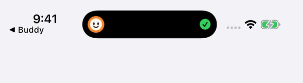

# Buddy for iPhone

Buddy lives in the real **Dynamic Island**. Ask a question (or let Buddy read your last screenshot) and it thinks, answers and stays there as a Live Activity, on the Lock Screen too.



## Install (free, no App Store)

Buddy isn't on the App Store, so you sign it once with your own free Apple ID:

1. Download `Buddy-iOS.ipa` from the [latest release](https://github.com/juw12/buddy/releases/latest).
2. Install it with [Sideloadly](https://sideloadly.io) (Windows or Mac, plug in the iPhone) or [AltStore](https://altstore.io).
3. On the iPhone: Settings → General → VPN & Device Management → trust your Apple ID. On iOS 16+ also turn on Settings → Privacy & Security → Developer Mode.
4. Open Buddy and allow Photos (for "my last screenshot"). Live Activities are on by default.

With a free Apple ID the app has to be re-signed every 7 days. AltStore does this for you over Wi-Fi.

## Updates

- **AltStore:** add the source `https://juw12.github.io/buddy/altstore.json` (Browse → Sources → +). AltStore shows new Buddy versions and installs them.
- **Sideloadly:** Buddy checks `https://juw12.github.io/buddy/latest.json` when it opens and shows a "New version" banner with a download link. Install the new IPA the same way. Your settings stay.

iOS doesn't allow sideloaded apps to update themselves silently.

## Ask without leaving your app

- **Back Tap:** Settings → Accessibility → Touch → Back Tap → Double Tap → **Ask Buddy about my screen**. Take a screenshot, double-tap the back of the phone, and the answer appears in the Dynamic Island.
- **Action Button** (iPhone 15 Pro and later): Settings → Action Button → Shortcut → Ask Buddy about my screen.
- **Siri:** "Ask Buddy".
- **Widget:** add the Ask Buddy widget to the Home Screen or Lock Screen.
- Tap the island to open Buddy. Long-press it to read the whole answer.

## Brain

Buddy for iPhone uses the same shared free brain as the web island (with its daily limit). Nothing is stored. Your question and picture are sent only to answer.

## Build it yourself

The project is generated with [XcodeGen](https://github.com/yonaskolb/XcodeGen) from `project.yml`:

```sh
brew install xcodegen
cd ios && xcodegen generate && open Buddy.xcodeproj
```

The [iOS workflow](../.github/workflows/ios.yml) builds on every push. It runs the unit tests, runs a Simulator self-test that asks the real brain and checks that the island is showing, saves screenshots, and packages the unsigned `Buddy-iOS.ipa`.

Not yet tested on a physical iPhone: CI covers the Simulator only.
